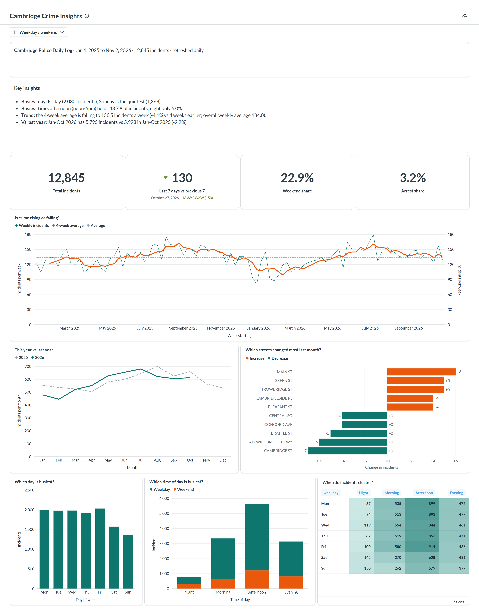
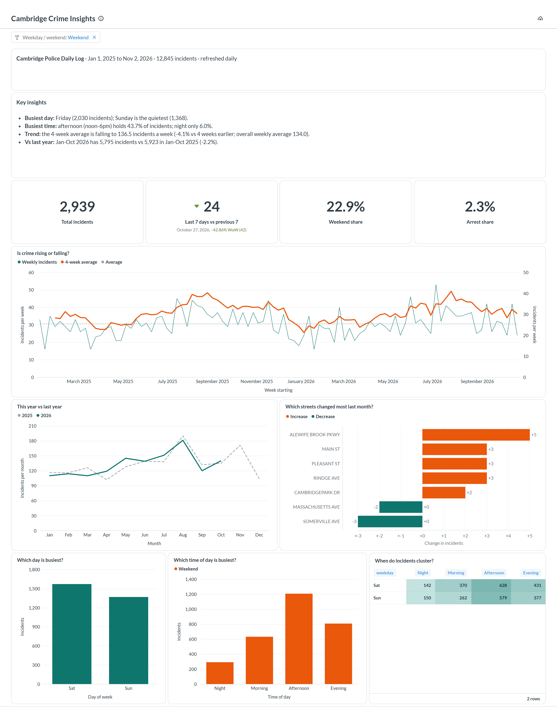

# Cambridge Crime Insights

**An automated data pipeline and dashboard for the Cambridge (MA) Police Daily Log.**

> **PAI-102 Data Engineering** · Thapar Institute of Engineering and Technology, Patiala
> **Student:** Monika

## What this project does

The City of Cambridge publishes every police log entry as open data
([Socrata dataset `3gki-wyrb`](https://data.cambridgema.gov/)). This project downloads that data
every day, checks and cleans it, stores it in a PostgreSQL database, and shows it in a
Metabase dashboard called **Cambridge Crime Insights**. The dashboard answers simple
questions: *Is crime rising or falling? Which day and time are busiest? Which streets changed most?*

It was built as a rewrite of an original Colab notebook into a real,
repeatable pipeline that runs on a schedule, on a laptop (Docker) and on an AWS server.

## Architecture

```
                 Prefect flow "cambridge_crime_etl"  (daily, 06:00 America/New_York)
        ┌───────────────────────────────────────────────────────────────────┐
Socrata ─► Extract ─► Validate ─► Transform ─► Load ─► PostgreSQL ─► Metabase
  API     (sodapy)   (quality     (13 derived   (COPY +    table        dashboard
           ordered     checks)     columns)     UPSERT)   cpd_logs      (10 cards)
           by :id
```

| Step | File | What it does |
|---|---|---|
| Extract | `pipeline/extract.py` | Pages through the whole dataset in a stable order (`:id`), with a timeout and retries |
| Validate | `pipeline/validate.py` | Checks columns, numeric ids, date parsing and null rates; prints a quality summary |
| Transform | `pipeline/transform.py` | Removes duplicates; adds weekday/weekend, time of day, week start, clean street name, etc. |
| Load | `pipeline/load.py` | Bulk `COPY` into a temp table, then `INSERT … ON CONFLICT (id) DO UPDATE` (safe to re-run) |
| Orchestrate | `pipeline/flow.py` | Prefect flow; run once or serve on a daily schedule |
| Dashboard | `metabase/build_dashboard.py` | Builds the whole dashboard through the Metabase REST API |

## Tools used

Python 3 · pandas · sodapy · SQLAlchemy / psycopg2 · **Prefect 3** · **PostgreSQL 16** ·
**Metabase** · **Docker & Docker Compose** · **AWS EC2** (Ubuntu, systemd) · Git/GitHub

## Dashboard

A single-screen dashboard with 10 cards (KPIs, weekly trend, year-over-year, busiest day and
time, heatmap, street changes) and one **Weekday / Weekend** filter. Numbers are anchored on the
latest record in the data, not on today's date, so a lagging feed never shows an empty week.





More screenshots:

- All dashboard screenshots: [report_assets/screenshots/](report_assets/screenshots/)
- One image per card: [report_assets/screenshots/cards/](report_assets/screenshots/cards/)
- Docker containers and the warehouse row count: `04_docker_ps.png`, `08_row_count.png` in the same folder
- Architecture diagrams: [report_assets/architecture.png](report_assets/architecture.png),
  [report_assets/dashboard_data_flow.png](report_assets/dashboard_data_flow.png)

## How to run it (Windows 11, PowerShell)

**Prerequisites:** Docker Desktop (running), Python 3.11+, Git. Docker is used for PostgreSQL and Metabase;
the Python pipeline runs on your machine. On Linux/macOS use `cp .env.example .env` and
`source .venv/bin/activate` instead of the PowerShell equivalents.

### 1. Get the code and configure

```powershell
git clone https://github.com/monika0310-byte/cpd-crime-trends.git
cd cpd-crime-trends
Copy-Item .env.example .env      # then open .env and replace every change-me value with your own password
```

`.env.example` contains placeholders only. `.env` is ignored by Git and must never be committed. `SOCRATA_APP_TOKEN` is optional
(it only avoids throttling).

### 2. Start the databases and Metabase (Docker)

```powershell
docker compose up -d             # reads passwords from .env
docker compose ps                # wait until warehouse and metabase are "healthy"
```

This starts three containers on a private network: `warehouse` (PostgreSQL, reachable from your
PC on port 5433), `mb_appdb` (Metabase's own database) and `metabase` (http://localhost:3000).

### 3. Python environment and pipeline

```powershell
python -m venv .venv
.\.venv\Scripts\Activate.ps1
pip install -r requirements.txt

python -m pipeline.flow            # run once: extract → validate → transform → load
python -m pipeline.flow --serve    # keep running; triggers every day at 06:00 New York time
```

Check the load:

```powershell
docker exec cpd_warehouse psql -U <WAREHOUSE_USER> -d cpd_insights -c "SELECT count(*), max(date_time) FROM cpd_logs;"
```

Running the pipeline again is safe: rows are matched on `id` and updated in place.

### 4. Metabase dashboard

1. Open http://localhost:3000 and create the admin account (first start takes 1–2 minutes).
2. Set the admin login for the build script, then run it:

```powershell
$env:MB_EMAIL = "<your Metabase admin email>"
$env:MB_PASSWORD = "<your Metabase admin password>"
python metabase\build_dashboard.py
```

It connects Metabase to the warehouse (host `warehouse`, port `5432` *inside* Docker), creates
the 10 SQL cards and the dashboard "Cambridge Crime Insights". Run
`python metabase\build_dashboard.py --refresh-text` after new data arrives to refresh the header and
"Key insights" text cards (the number cards update on their own).

> The live SQL for every card is in `metabase/build_dashboard.py`.
> `sql/dashboard_queries.sql` is from an earlier design and is kept only for reference.

## The `cpd_logs` table

Source columns: `id`, `date_time`, `type`, `subtype`, `location`, `description`, `last_updated`.
Derived: `date`, `year`, `month`, `month_name`, `day`, `hour`, `day_of_week`, `dow_num`,
`is_weekend`, `time_of_day` (Night / Morning / Afternoon / Evening), `week_start`, `street`,
`description_length`, `loaded_at`. Primary key `id`; indexes on `date_time`, `type`, `street`.

## AWS deployment (short note)

The same project runs on a single **EC2 instance** (Ubuntu 24.04, `t3.small`, Sydney region):

- Docker Compose runs PostgreSQL and Metabase with `restart: unless-stopped`.
- Two **systemd** services keep the scheduler alive after reboots: a local Prefect server and the
  ETL flow (`deploy/cpd-prefect.service`, `deploy/cpd-etl.service`).
- The database ports are bound to localhost only; only SSH and the Metabase port are open.
- A weekly `pg_dump` backup runs from cron (`scripts/backup.sh`, newest 8 kept, restore tested).
- Step-by-step operations (logs, restart, update, restore, public share link): see
  [DEPLOYMENT.md](DEPLOYMENT.md).

## Accuracy decisions

- "Last 7 days" is measured back from the latest record, not from today.
- Weekly and monthly charts use **complete** weeks and months only (partial ones are dropped).
- Counts use `COUNT(DISTINCT id)`.
- The street-change card only keeps streets with at least 3 incidents in either month.

## Differences from the original notebook

| Notebook | This project |
|---|---|
| Tasks inline in one notebook | Python package with one command-line entry point |
| `get_all()` with no order (offset paging can return duplicates and miss rows) | Ordered by `:id`: exact row count, no duplicates |
| Append-only `to_sql` | `COPY` + `UPSERT`, primary key, indexes, safe re-runs |
| Split timestamp into parts | 13 analysis-ready columns (weekday/weekend, time of day, clean street…) |
| Local only, one page of totals | Docker + AWS, scheduled daily, 10-card dashboard with a filter |

## More documents

- [PROJECT_EXPLANATION.md](PROJECT_EXPLANATION.md): the whole project in plain language
- [DEPLOYMENT.md](DEPLOYMENT.md): AWS operations guide

## Repository layout

```
pipeline/      extract, validate, transform, load, flow
metabase/      build_dashboard.py (dashboard built via REST API)
deploy/        systemd service files for AWS
scripts/       backup.sh
sql/           earlier SQL draft (reference only)
report_assets/ diagrams and screenshots
docker-compose.yml · requirements.txt · .env.example
```
